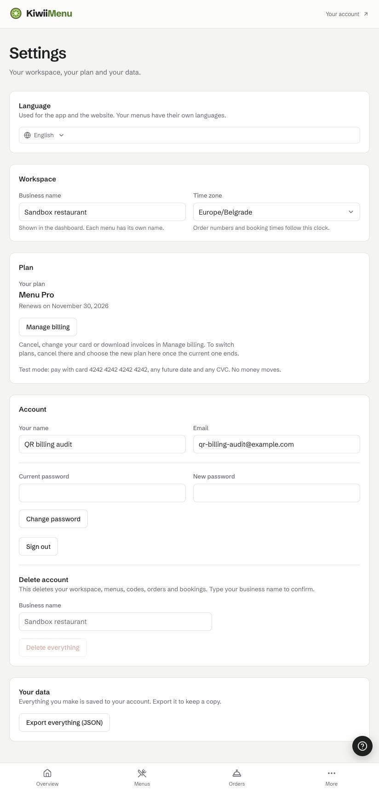
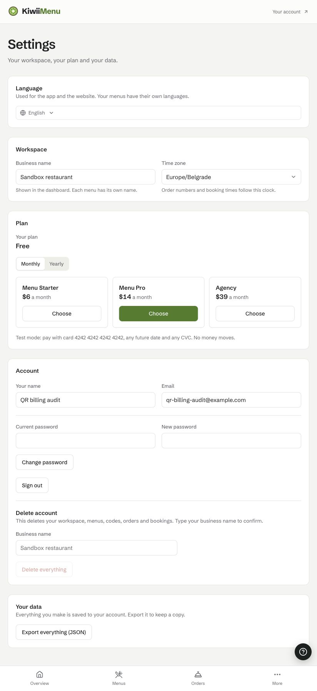

# QR Lab first: Paddle resilience implementation and verification

**Result:** local sandbox gate passed. Keep the kit's existing architecture and the app's existing policy boundary. The unreleased candidate adds bounded provider calls, a process-local circuit breaker, durable recovery and truthful health. QR Lab uses those shared mechanisms and closes its enforcement/rotation/configuration gaps. The changes are on local `codex/qr-lab-resilience` branches; no tag, push or hosted deployment was made. Slopremover and Offday have not been changed in this phase.

This follows the [original review](2026-10-30-paddle-kit-review.md). That review describes the earlier code; the targeted findings below now have implementation and verification evidence.

## Changes and boundaries

| Concern | Shared kit behavior | QR Lab responsibility |
|---|---|---|
| Provider outages | Full JSON attempt deadline 4 s, operation budget 10 s, GET-only bounded retries with jitter/Retry-After; sanitized errors, allowed Paddle origins, no redirects | Reuse one transport per environment for prices, portal and recovery |
| Circuit breaker | Three failed operations → 30 s open; 429 cooldown; one half-open probe; stale requests cannot close a newer circuit | Expose circuit state through authenticated health; keep incoming webhooks and local reads independent |
| Recovery | Durable leased job, expired-lease takeover, fenced completion, all-history initial scan, successful-start checkpoint with one-hour overlap; partial/timeout/pagination failure retains checkpoint | Authenticated daily cron and CLI use the same runner, 45 s work budget / 60 s route budget, HTTP 500 or nonzero exit on failure |
| Abandoned events | Recover eligible unfinished original event IDs through the documented provider event stream, then repair subscriptions/payments; leave unresolved failures visible | Idempotent domain hooks where present; packs remain deferred |
| Subscription grace | Atomic transition in memory/Postgres/SQLite, ignoring stale snapshots; old `upsertSubscription` interface preserved | Seven-day grace and plan/tier policy remain app decisions |
| Health | Durable unresolved failures, oldest pending work; doctor no longer lets a later harmless reason or foreign traffic conceal those failures | Recovery freshness (36 h), real price source, circuit check; first recovery must succeed before green |
| Configuration | Existing generic parser/secret arrays remain reusable | Validate monthly/yearly maps; pass all rotation secrets; enforced unavailable billing refuses paid writes with 503 while plan reads remain available |
| Checkout | Existing Paddle.js + signed server verification | Keep Manage billing for active/trialing/past_due/paused subscriptions even when paid access has expired |

The kit extends `a2912a5`. QR Lab extends integration commit `1f07091` in `/Users/gentlegen/Desktop/Projects/QR-Lab/.claude/worktrees/paddle-kit-070-test-a7db49`. Its package is pinned to `vendor/paddle-kit-0.8.0-qr.1.tgz`, SHA-256 **`8a88bf7d2c3d032ba08ec67372f91be452d8cbc2d3a4504bac8c6d21507179f5`**. Use the same exact immutable artifact when reviewing another consumer; a version string alone does not establish identical bytes.

The circuit intentionally belongs to a warm process. A restart resets it; it is not distributed rate limiting. Durable job state and checkpoints survive application instances through the shared database. Hook effects remain at least once. Cancellation is propagated where supported, but already-started database writes or external side effects may finish. Code must not rely on exactly-once execution.

Grace intentionally does not infer episode boundaries from stale events. This may grant extra grace if the first observed overdue snapshot is late. A current snapshot cannot reconstruct an entirely missed recovery followed by a new delinquency; that history needs provider inspection. A minimum timestamp across all delinquency episodes would revoke access too early.

## Verification

| Check | Result |
|---|---|
| Kit ordinary tests | 460 passed, 25 files |
| Kit real Postgres 17.10 | 5 passed; 1,000 events, 0 errors |
| Kit TypeScript, build, edge bundle check | Passed; 15 edge-safe files, 0 violations |
| Packed consumer smoke | Passed: package imports, NodeNext types, both CLIs and signed webhook behavior |
| QR Lab full suite after Next patch | 209 passed, 1 optional Postgres case skipped |
| QR Lab real postgres-js/Drizzle boundary | Optional case separately passed on real Postgres: 20 concurrent copies, competing recovery jobs, state across instances, atomic grace |
| QR Lab resilience integration tests | 6 passed, including rotation of the same event ID, fail-closed writes, incomplete recovery then retry, persisted checkpoint beyond seven days, cron misconfiguration HTTP 500 |
| QR Lab production build and lint | Passed |
| Dependency security | Previous Next 16.4.0 had a critical published advisory; patched Next + eslint-config-next to 16.4.3. Production audit then reported 0 known advisories |

The reliability tests include retry bounds, permanent authentication failure, non-retried mutations, Retry-After, stalled fetch and body reads, cancellation, circuit trip/single probe/recovery, stale in-flight completion, page limits, abandoned claims, checkpoint retention and recovery, job fencing, and false-green health scenarios. Baseline and final counts must not be added together as independent coverage.

Next advisory evidence: [official security update](https://nextjs.org/blog/nextjs-security-update-october-14-2026), [patched release](https://github.com/vercel/next.js/releases/tag/v16.4.3). An audit with no known advisories is not a guarantee that application code is secure.

## Real sandbox evidence

User selected **local QR Lab with a sandbox tunnel**. Verification used a disposable app copy and independent local PGlite database, sandbox-only credentials, an isolated catalog named `qr-lab-resilience-audit-20261030`, fake account details and Paddle's test card. Billing enforcement was enabled. No live purchase or live account setting was used.

1. The public HTTPS tunnel delivered signed Paddle webhooks to local `/api/paddle`. An authenticated Pro monthly checkout completed, and Settings changed from Free to Menu Pro. Reloading independently preserved the server-authorized tier.
2. Test subscription `sub_01m66czyj8k1rwd1vc6tnx6jqd` was active. Only the isolated destination `ntfset_01m66c32jetv549sw21th1gwas` was deactivated, then the subscription was canceled immediately through the sandbox API. Reloaded Settings still showed Pro, establishing a missed cancellation.
3. The authenticated cron returned HTTP 200 with `status: done`. Reloaded Settings showed Free. Authenticated health showed the circuit closed, last successful recovery `2026-10-30T12:38:11.685Z`, and starter/monthly `$6 from Paddle`.
4. Original event lookup was independently checked against the real sandbox: the time/type-window query found the exact event ID. There is no assumed GET-by-event-ID endpoint, and the API's `filter` is not used as an envelope event-ID search. [Paddle event stream and 90-day retention](https://developer.paddle.com/api-reference/events/list-events/).
5. Cleanup canceled the test subscription, archived the isolated product/prices, deactivated its destination, revoked the disposable client token, and stopped the tunnel/dev server. Sandbox historical records remain in Paddle. No secrets were copied into either review branch.

Sandbox upgrade:

After intentionally missing cancellation and running recovery:

## Operation and remaining gates

Run migration **003_recovery** before enabling this runner on Neon. QR Lab's existing `db:migrate` applies all kit migrations; PGlite applies them on startup. Give the recovery key `notification.read`, `subscription.read`, `transaction.read`, `adjustment.read`; pricing/portal need their own documented permissions. Keep catalog administration separate where practical.

Use `npm run billing:reconcile` for a standalone Neon process. With a running local PGlite app, call the authenticated cron instead of opening the same PGlite files in another process. Check `billing:doctor` afterward. The first successful recovery initializes health; misconfiguration, partial work, an expired lease or stale success must remain visible.

Still required before live rollout: hosted migrations/cron credentials and execution, central watcher/alert delivery, production destination configuration, natural renewal and failed renewal, every tier/cycle through real checkout, real refund/dispute lifecycle and live seller readiness. Those are not established by this local sandbox run. No central watcher deployment was changed. Recovery cannot fetch original events beyond Paddle's retention; permanent payload/hook failures require a person. Large accounts may need a separately designed bounded backfill rather than increasing timeouts indefinitely.

The candidate is ready for code review and the next hosted sandbox gate. It has not been published as a production release. Continue the other applications one at a time, preserving their domain rules rather than moving them into the shared provider kit.
